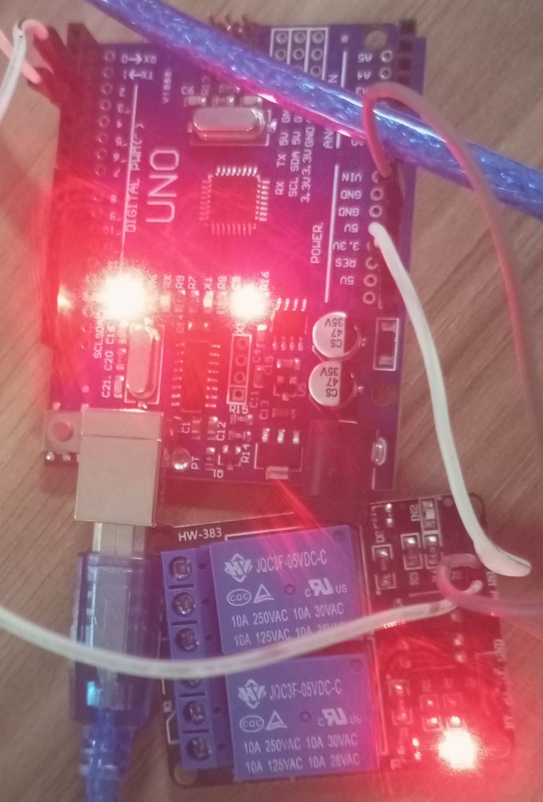

# Two-Channel-Relay
# About
A beginner-friendly Arduino project demonstrating how to control a two-channel relay module. The relay allows Arduino to switch two separate electrical loads ON and OFF using digital signals.
# Components Required
- Arduino Uno
- Two-Channel Relay Module
- Jumper Wires
- Breadboard
# Working
1. Connect the relay module to the Arduino.
2. Arduino sends digital signals to the relay module.
3. Each relay channel can be controlled independently.
4. When a relay is activated, its contacts switch the connected circuit.
5. Both channels can be controlled individually through the Arduino code.

# Output

# Arduino Code
[View Arduino Code](./2relay.ino)

# Learning Outcome
Learned how relay modules work, how to control two independent channels using Arduino, and how relays are used in home automation and electrical switching applications.
